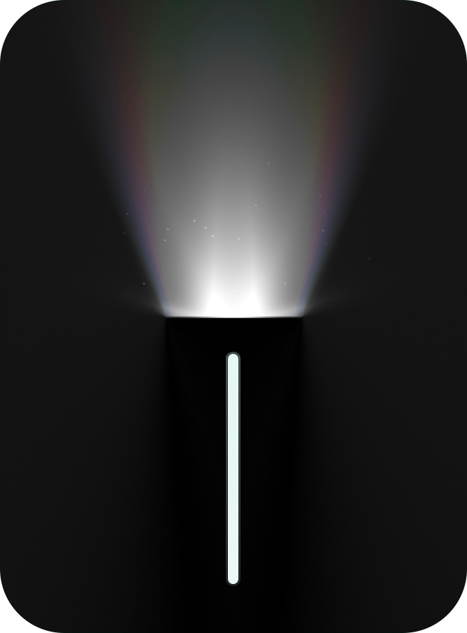
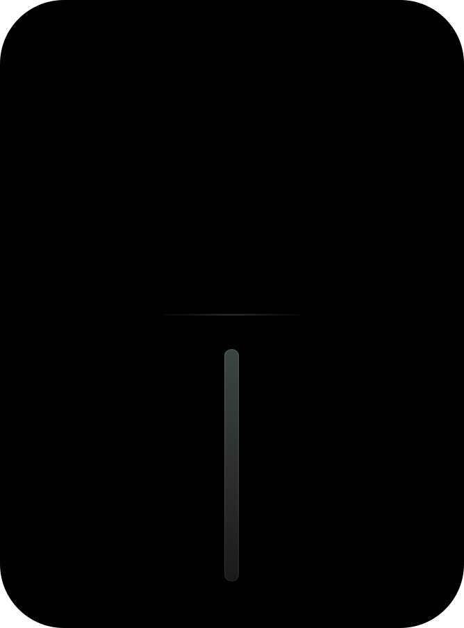

# HyperTorchIsland

[English](README_en.md)

适用于 HyperOS 的 LSPosed 模块（libxposed API 102），可以直接在手电筒超级岛里调节亮度。

<p align="center">
  
  &nbsp;&nbsp;
  
</p>

## 功能

- 打开手电筒时超级岛自动展开，不会在 5 秒后自己收回去。
- 展开后是屏幕顶部居中的竖向卡片，圆角直接使用系统的 `island_radius`，和原生岛的描边完全贴合。
- 卡片内容直接复用 `miui.systemui.plugin` 自带的 `MiFlashlightLayout`，包括 GL 光束动效、竖向滑条、震动反馈和多语言文案，同时隐藏了开关按钮和上滑提示条。
- 上下拖动调节亮度。拖到 0 会关闭手电筒，但岛不会重建，往上拖就能重新打开。
- 手电筒不支持调光时不会出现空岛：岛里改为显示原生的开关按钮，位置与系统全屏手电筒页的降级形态一致，点击即可关灯。
- 左右滑动或点击岛外区域即可收起，点击卡片内部不会再跳转到全屏手电筒页面。
- 显示手电筒界面时不会再禁用状态栏。
- 如果收起岛时手电筒已关闭，手电筒通知会一起移除。

## 环境要求

- 带超级岛的 HyperOS。已在 `OS4.0.24.0.XFRCNXM` 和 `OS4.0.4.0.XBLCNXM`（Android 17 / SDK 37）上测试，其他版本未经测试。
- Root，以及支持现代 libxposed API 102 的 LSPosed。
- 手电筒支持多级亮度（`FLASH_INFO_STRENGTH_MAXIMUM_LEVEL >= 100`）时提供亮度滑条；不支持时岛里显示原生开关按钮。

## 安装

1. 从 [Releases](https://github.com/Xposed-Modules-Repo/io.github.leset0ng.hypertorchisland/releases) 下载 APK 并安装，或者自行构建（见下文）。
2. 在 LSPosed 中启用模块，作用域固定为 `com.android.systemui`（系统界面）。
3. 重启系统界面或重启手机：

   ```sh
   adb shell killall com.android.systemui
   ```

模块生效后，再覆盖安装新版本会热重载到正在运行的系统界面，不需要重启。

## 构建

需要 JDK 17+ 和包含 platform 37 的 Android SDK。

```sh
./gradlew :app:assembleRelease
# app/build/outputs/apk/release/app-release.apk
```

Release 包开启了代码压缩。如果设置了 `TORCH_ISLAND_KEYSTORE_PATH`、`TORCH_ISLAND_KEYSTORE_PASSWORD`、`TORCH_ISLAND_KEY_ALIAS` 和 `TORCH_ISLAND_KEY_PASSWORD`，就用这个密钥签名，否则使用 debug 密钥。指定版本号：

```sh
./gradlew :app:assembleRelease -PtorchIslandVersionCode=2 -PtorchIslandVersionName=0.2.0
```

## 实现原理

超级岛和手电筒界面的代码都在 `MIUISystemUIPlugin.apk`（`miui.systemui.plugin`）中，由系统界面通过独立的 ClassLoader 加载到自己的进程里。模块主要做了这几件事：

1. Hook 系统界面的 `DynamicIslandPluginController#onPluginLoaded`，拿到插件的 ClassLoader 和 `Context`。
2. 把手电筒岛的展开视图和过渡动画用的 fake 视图换成模块自己的宿主视图（`ui/TorchIslandHost.kt`）。岛展开时，宿主视图通过 `MiFlashlightManager` 创建原生的 `MiFlashlightLayout`。
3. 调整展开岛的尺寸并水平居中，把竖向拖动交给滑条处理，同时屏蔽全屏页面原有的副作用：禁用状态栏、写入“手电筒页面正在显示”标记、以错误的 UID 发通知。
4. 把手电筒焦点通知里的 `miui.island.firstFloat` 改为 `true`，通知一发出岛就展开。

所有 Hook 只对手电筒岛生效，其他岛保持原样。如果有目标解析失败，插件侧的 Hook 会全部跳过，系统界面保持原生行为。

日志写入 LSPosed 日志，标签为 `HyperTorchIsland`。

## 已知限制

- Hook 目标按类名和方法名解析。如果 HyperOS 更新后改了名字或签名，模块会失效，需要更新解析逻辑后才能恢复。
- 在模拟器上，手电筒的最大亮度档位会被强制设为 100，方便测试滑条。

## 许可证

Copyright 2026 leset0ng

基于 [Apache License 2.0](LICENSE) 开源。

本项目与小米公司无关，也未获得其认可。HyperOS 和 MIUI 是小米公司的商标。
