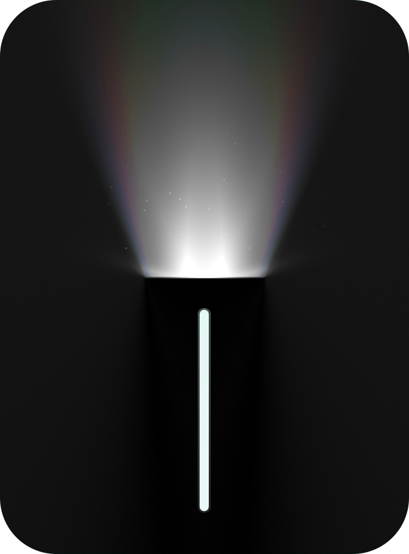
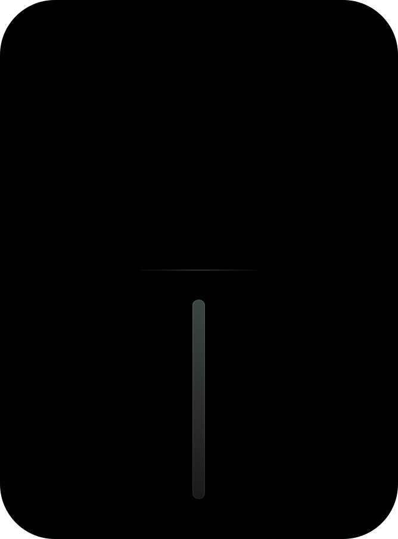

# HyperTorchIsland

[简体中文](README.md)

An LSPosed module (libxposed API 102) for HyperOS that turns the flashlight Super Island into an in-place brightness control.

<p align="center">
  
  &nbsp;&nbsp;
  
</p>

## Features

- The island expands on its own when the torch turns on and stays open instead of collapsing after 5 seconds.
- The expanded island is a tall card centered at the top of the screen. It uses the system `island_radius`, so its corners line up with the stock island outline.
- The card hosts the stock `MiFlashlightLayout` from `miui.systemui.plugin`: the GL beam effect, the vertical seekbar, haptics and localized strings. The on/off button and the swipe-up hint are hidden.
- Drag vertically to change brightness. Dragging to zero turns the torch off without rebuilding the island, so you can drag back up to turn it on again.
- Swipe sideways or tap outside to collapse. Tapping inside the card no longer opens the full-screen flashlight page.
- The status bar is no longer disabled while the flashlight UI is on screen.
- If the island collapses while the torch is off, the flashlight notification is removed.

## Requirements

- HyperOS with Super Island. Tested on `OS4.0.24.0.XFRCNXM` and `OS4.0.4.0.XBLCNXM` (Android 17 / SDK 37). Other builds may work but have not been tested.
- Root and an LSPosed build that supports the modern libxposed API 102.
- A torch with adjustable strength (`FLASH_INFO_STRENGTH_MAXIMUM_LEVEL > 1`). Without it, there is no brightness slider.

## Install

1. Build the APK (see below) and install it.
2. Enable the module in LSPosed. The scope is fixed to `com.android.systemui` (System UI).
3. Restart System UI or reboot:

   ```sh
   adb shell killall com.android.systemui
   ```

Once the module is active, reinstalling it hot reloads into the running System UI, so later updates don't need a restart.

## Build

You need JDK 17+ and an Android SDK with platform 37.

```sh
./gradlew :app:assembleRelease
# app/build/outputs/apk/release/app-release.apk
```

Release builds are minified and signed with the debug key. To override the version:

```sh
./gradlew :app:assembleRelease -PtorchIslandVersionCode=2 -PtorchIslandVersionName=0.2.0
```

## How it works

The Super Island and the flashlight UI live in `MIUISystemUIPlugin.apk` (`miui.systemui.plugin`), which System UI loads into its own process through a separate class loader. The module:

1. Hooks `DynamicIslandPluginController#onPluginLoaded` in System UI to get the plugin class loader and `Context`.
2. Swaps the flashlight island's expanded and fake views for its own host views (`ui/TorchIslandHost.kt`). When the island expands, the host view creates the stock `MiFlashlightLayout` through `MiFlashlightManager`.
3. Resizes and recenters the expanded island, lets vertical drags through to the seekbar, and blocks the side effects the full-screen page normally has: disabling the status bar, the "flashlight page showing" flag, and posting notifications as the wrong UID.
4. Rewrites `miui.island.firstFloat` to `true` on the flashlight focus notification so the island expands as soon as it's posted.

Hooks only act on the flashlight island. Other islands keep their stock behavior. If a target can't be resolved, the plugin hooks are skipped and System UI keeps its stock behavior.

Logs use the tag `HyperTorchIsland` in the LSPosed log.

## Limitations

- Hook targets are resolved by class and method name. A HyperOS update that renames or reshapes them will break the module until the resolver is updated.
- On the emulator, the torch's maximum strength is forced to 100 so the slider can be tested.

## License

Copyright 2026 leset0ng

Licensed under the [Apache License, Version 2.0](LICENSE).

This project isn't affiliated with or endorsed by Xiaomi. HyperOS and MIUI are trademarks of Xiaomi.
